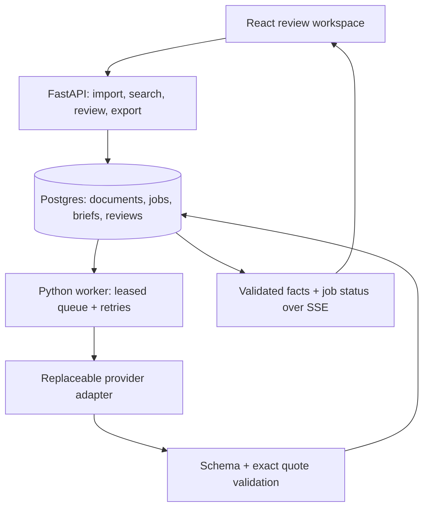

# Biddy

**An evidence-first bid/no-bid copilot for small government contractors.**

Biddy extracts solicitation requirements, lets a reviewer inspect the exact source passage behind each finding, and records a human bid, no-bid or hold decision against an immutable brief version.

**Repository:** https://github.com/garvj65/biddy-online

**Live review workspace:** https://biddy-bid-copilot.garvjhajharia6.chatgpt.site

The live URL hosts the React frontend and a working device-local text scan. The FastAPI service, worker and Postgres are included as a separate Docker stack; they are **not hosted at the live URL**. Connect a deployed service using **Connections**. The initial sample is fictional and explicitly labeled. No contractor interviews, real users or real-solicitation accuracy numbers are claimed.

## What works in v0.1

| Capability | Live frontend, without API | Connected FastAPI stack |
|---|---|---|
| Paste solicitation text / upload TXT or Markdown | Local deterministic rules scan | Background processing with the configured provider |
| Readable PDF / DOCX | Requires connected service | Parsed pages / explicitly labeled DOCX sections |
| Government document link | Requires connected service | Bounded public HTTPS `.gov` document import |
| Source-linked findings | Exact extracted-text highlighting | Exact quote and page/section offsets, verified server-side |
| Review and export | Device-local decision history and Markdown | Database-backed decision audit and Markdown |
| Search | This device's loaded documents | Postgres full-text index plus frontend filtering |
| Company profile | Device-local reference | Saved workspace reference; no automated eligibility claim |
| AI provider | None; sample and rules are labeled | OpenAI, compatible Chat Completions endpoints, Anthropic, Gemini |

This is a single-workspace MVP. Its configured bearer token grants access to that workspace; it is not a multi-tenant SaaS authentication system. The original file is parsed into retained text; v0.1 displays extracted text rather than a pixel-perfect PDF overlay. It does not retain or serve the uploaded binary.

## Quick start with Docker

Prerequisites: Docker Engine with Compose. From the project root:

```bash
cp .env.example .env
# Edit .env: set random POSTGRES_PASSWORD and BIDDY_ACCESS_TOKEN values.
# Keep LLM_PROVIDER=rules for the first no-cost pipeline check.
docker compose up --build -d
```

Open http://localhost:8080. In **Connections**, enter `http://localhost:8080` and the `BIDDY_ACCESS_TOKEN` from `.env`. Add a solicitation, wait for processing, open a finding, verify it, then record a decision.

The first startup runs Alembic migrations before starting the API and worker. Postgres data lives in the `postgres_data` volume. The worker consumes a durable database queue. The API and database ports stay internal to Compose; Nginx exposes the frontend and `/api` on port 8080.

```bash
docker compose logs -f api worker
docker compose down
# Keep the data volume unless you intentionally want to erase the workspace.
```

For an Internet deployment, place this stack behind an HTTPS reverse proxy, use strong secrets, and restrict access to your intended pilot users. To use the published frontend against your hosted API, add that frontend origin to `CORS_ORIGINS`, deploy the stack on your Docker host, and connect its HTTPS API URL. No external VM, database account or hosting subscription was provisioned in this session.

## Switch LLM providers

Set these on the **server**, then restart both `api` and `worker`:

```dotenv
LLM_PROVIDER=openai
LLM_API_KEY=your-provider-key
LLM_MODEL=your-available-structured-output-model
LLM_BASE_URL=https://api.openai.com/v1
```

| Provider | Configuration / behavior |
|---|---|
| `rules` | No key; conservative extraction of verbatim paragraphs. This is a baseline, not an LLM. |
| `openai` | Chat Completions with strict JSON Schema output. |
| `openai-compatible` | Same contract at `LLM_BASE_URL`; endpoint and model must support `response_format.json_schema`. Merely accepting a key is insufficient. |
| `anthropic` | Native Messages API with an extraction tool schema. Select a model supporting forced tool use. |
| `gemini` | Native Generate Content API with a JSON response schema. Select a model supporting this API and schema mode. |

Provider selection includes the matching model and API key; different providers' keys are not interchangeable. Keys stay in server environment variables and are not sent to the browser, committed, or returned in API errors. The frontend access token is held only in tab memory. The published frontend has no model key.

Adapters have mocked contract tests. **Paid provider calls have not been executed** because no key was supplied. Provider/model availability and JSON Schema support must be checked with your account before a pilot. Invalid structured output fails visibly; the app never silently switches to a paid provider or presents rules output as AI output.

Optional `LLM_INPUT_USD_PER_MILLION` and `LLM_OUTPUT_USD_PER_MILLION` values calculate token-based **cost estimates** from returned usage. No prices are assumed. Provider-specific discounts, caching, reasoning tokens and billing adjustments may differ from that estimate.

API protocol references: [OpenAI structured outputs](https://developers.openai.com/api/docs/guides/structured-outputs), [Anthropic tools](https://platform.claude.com/docs/en/agents-and-tools/tool-use/define-tools), [Gemini Generate Content structured output](https://ai.google.dev/gemini-api/docs/generate-content/structured-output).

## Local development without Docker

Prerequisites: Python 3.12+ and Node 22+. SQLite is supported for one local worker; use Postgres for concurrent production workers.

```bash
python -m venv .venv
.venv/bin/pip install -r backend/requirements.txt
cp .env.example .env
npm ci
```

Run migrations, then the API, worker and frontend in separate terminals:

```bash
# Terminal 1
cd backend
../.venv/bin/alembic upgrade head
../.venv/bin/uvicorn app.main:app --host 127.0.0.1 --port 8000

# Terminal 2, from project root
cd backend
../.venv/bin/python -m app.worker

# Terminal 3, from project root
npm run dev
```

Open the Vite URL. Connect `http://localhost:8000` with your workspace token. The server reads the root `.env` in this checkout. OpenAPI is generated at `/openapi.json` and interactive docs are at `/docs` on the API service. Use your environment's equivalents for activation and Python paths on Windows.

## Architecture



Why Postgres full-text before a vector database: the first search need is finding known procurement terms, registrations, identifiers and requirements across previously ingested text. Full-text search offers stemming, ordinary SQL filters and a GIN index within the database already required for audit and transactions. It avoids introducing embedding generation and a second retrieval store before semantic search is a validated need. This is a v1 tradeoff, not a claim that keyword retrieval replaces semantic retrieval in every workflow.

Why a database job queue: one durable dependency keeps the initial deployment small and makes creation of the solicitation and its job transactional. Postgres workers claim with `FOR UPDATE SKIP LOCKED`; lease tokens prevent stale workers overwriting a newer attempt, heartbeats renew long jobs, and retry backoff handles failures. A broker can be introduced when measured workload justifies it.

Why compose the brief from verified facts: raw model tokens can contain unsupported claims before validation. v1 validates structured extraction, then serves source-linked facts and status through SSE. It does **not** stream unverified model prose into an approvable brief. Quotes are matched literally against retained source text. A quote match proves the passage exists, not that a model's paraphrase is semantically correct; human review and real document evals remain necessary.

## Verification and measurement

```bash
npm test
npm run build
cd backend
../.venv/bin/python -m pytest tests -q
../.venv/bin/python -m evals.run --persist
cd ..
.venv/bin/python scripts/verify_local.py
```

The eval contains **six synthetic fixtures**, including absent dates, amendments, prompt-like document instructions and missing timezones. It reports exact category/quote precision and recall, citation validity, gap checks and the human gate. Reports and the initially observed false positives are committed under `docs/validation/`. They are smoke tests, not a real solicitation benchmark. Expand to 30–50 independently labeled real documents before publishing accuracy claims; reserve a held-out set.

The eval command exits unsuccessfully when required gap checks, citation checks or human-review checks fail, or when exact category/quote F1 falls below `--min-f1` (default `0.9`). It writes the report even on failure, so CI failures remain inspectable. Processing settings reject zero/negative concurrency, attempts and invalid lease durations at startup rather than leaving jobs stuck.

The load harness measures actual HTTP import → durable job → worker → ready round trips, including queue wait and polling overhead. The included local run uses synthetic text and rules mode, so it says nothing about paid-model latency, Postgres contention or cloud capacity.

```bash
# Requires a running API and worker. Token comes from the environment.
export BIDDY_ACCESS_TOKEN=your-workspace-token
.venv/bin/python scripts/load_test.py --url http://localhost:8080 --concurrency 5 --requests 20
```

CI configuration includes frontend checks, Python tests, Postgres migrations, synthetic evals and a real API/worker network check against an ephemeral Postgres service. See [GitHub Actions](https://github.com/garvj65/biddy-online/actions) for the current workflow status. This environment has no Docker/Postgres executable, so Compose startup and live Postgres execution are unverified locally. The migration was applied on SQLite and generated successfully as Postgres SQL. Browser visual QA was unavailable; the TypeScript build and frontend domain logic were verified.

## Boundaries and next work

- Readable PDFs only; scanned/encrypted documents require preprocessing. Limits: 10 MB, 200 PDF pages, 180,000 extracted characters and 100 findings per brief.
- `.gov` link import is for readable public documents, with DNS-pinned public addresses, bounded reads and redirect revalidation. SAM.gov search/discovery, API-key-based opportunity ingestion, portal automation and non-government authenticated links are not implemented.
- DOCX and text use sections because their pagination is not reliable. The frontend locates the literal quote in the retained text; backend offsets use Python Unicode code points and local browser scans use JavaScript string indices.
- Full-text search works over ingested documents. It does not search the entire federal opportunities catalog.
- Company profiles provide reviewer context. Biddy does not automatically assert certifications, small business eligibility, amendment precedence or bid suitability.
- Decisions are versioned, append-only review records. Exporting a draft is allowed and visibly labels it unreviewed. Empty briefs, incomplete checks, missing rationale and stale brief versions cannot be approved through the API.
- No original binary retention, OCR, multi-file amendment consolidation, automatic proposal submission, external invitations, public sign-up, role management or automated fit score in v0.1.

See [the PRD](docs/PRD.md), [API and data contract](docs/SPEC.md), [contractor interview guide](docs/RESEARCH.md), [code review](docs/CODE_REVIEW.md), and [contribution guide](CONTRIBUTING.md). The next product milestone is deploying the Python stack, connecting a real provider, and putting real solicitations in front of 5–8 contractor reviewers.
